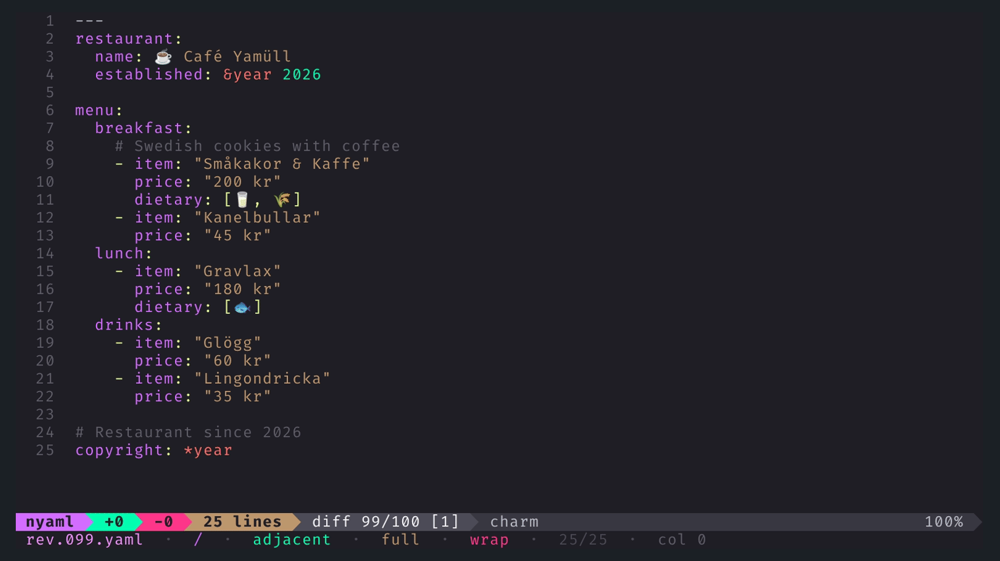
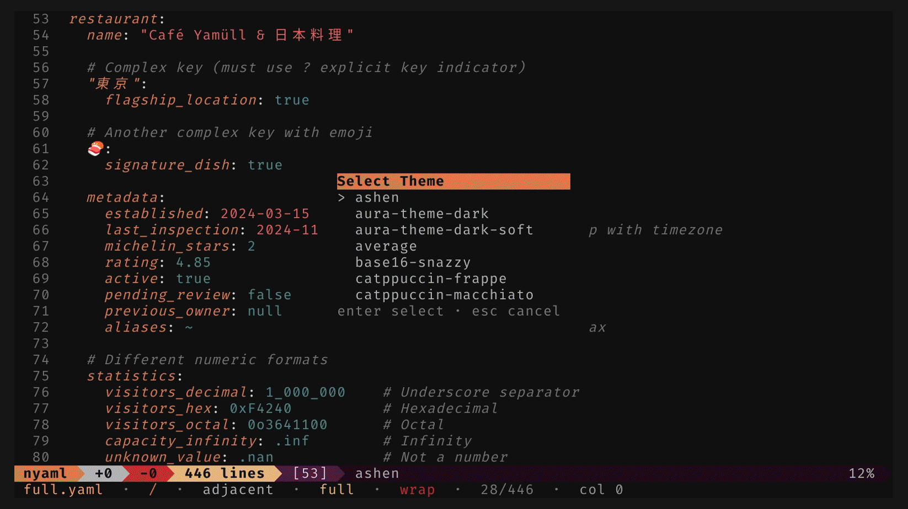
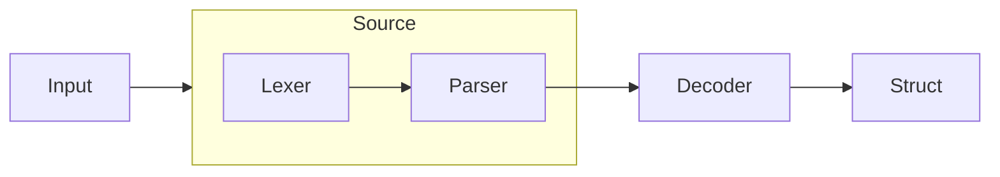

<p align="center">
  <h1 align="center">Nice YAML!</h1>
</p>

<p align="center">
  <a href="https://pkg.go.dev/go.jacobcolvin.com/niceyaml"></a>
  <a href="https://goreportcard.com/report/go.jacobcolvin.com/niceyaml"></a>
  <a href="https://codecov.io/gh/macropower/niceyaml"></a>
  <a href="#installation"></a>
  <a href="https://github.com/macropower/niceyaml/blob/main/LICENSE"></a>
</p>

Package `niceyaml` combines the powers of [go-yaml][goccy/go-yaml], [bubbletea][bubbletea], and more.

It enables **friendly and predictable handling of YAML-compatible documents** in your **CLI** or **TUI** applications, and includes:

- [`line.View`][niceyaml/line.View] **style overlay** and **annotation** system over a [`Source`][niceyaml.Source]
- Pretty [`printer`][niceyaml/printer] with [themes][niceyaml/style/theme]
- Rich [`Error`][niceyaml.Error] display using the above systems
- Source [**diffs**][niceyaml/diff] between revisions of a file
- String [`finder`][niceyaml/finder] for load-once, search-many scenarios
- [`Node`][niceyaml.Node] decoding with validation hooks, and a matching [`encoder`][niceyaml/encoder]
- JSON schema [validation][niceyaml/schema.Schema] with YAML path errors
- [`manifest`][niceyaml/manifest] loading and migration of configuration that declares its `apiVersion` and `kind`, as Kubernetes manifests do
- Bubble [`yamlviewport`][niceyaml/bubbles/yamlviewport] for Bubble Tea, in a module of its own
- [`fangs`][niceyaml/fangs] adapters for CLIs built with fang, in a module of their own
- Generic building blocks for your own bubbles

We use a **parse-once**, **style-once** approach. This means your users get a snappy UI, and you get a simple API. There's no need to employ multiple lexers, or perform any ANSI manipulation!

Every part of `niceyaml` shares one consistent **positioning system**. It addresses each cell on its own, and the display mode, such as a diff or a slice, adds no complexity.

## Features

### Search


### Revision Diffs



### Themes



### Validation


## Installation

```sh
go get go.jacobcolvin.com/niceyaml@latest
```

`niceyaml` requires Go 1.27 or later, since `Decode[T]` on `Source` and
`Node` is a generic method, which Go 1.27 introduced.

## Usage

### Core Abstractions

Module `niceyaml` adds a few abstractions on top of [go-yaml][goccy/go-yaml]:

- [`line.Line`][niceyaml/line] - Tokens for a single line of YAML content
- [`line.Lines`][niceyaml/line] - A collection of `Line`s, which never changes after creation
- [`line.View`][niceyaml/line] - One rendering of a `Lines` value, which carries the overlays, annotations, and flags the printer draws
- [`niceyaml.Source`][niceyaml.Source] - A YAML file, which parses into one `Node` per document, decodes, wraps errors, exposes its `Lines`, and returns fresh `View`s over them

Most use cases will only need to interact with `Source`. Its `Lines` method returns the `line.Lines` that the [`finder`][niceyaml/finder] and [`diff`][niceyaml/diff] packages read, and its `View` method returns a fresh `line.View` over them for the [`printer`][niceyaml/printer]. Both packages read a view too, so a search or a diff of one document takes the `View` of its `Node` and reports the lines of the file. Diffs return plain views, since interleaved lines from two revisions are not a YAML document. A program that edits a file in place reads the bytes of the file from `Text` and converts a position to a byte offset in them with `Offset`.

These abstractions let you iterate over arbitrary lines of tokens from one or more YAML documents, and they keep the original token details from the lexer. Multi-line and overlapping tokens cause common problems in diffs, partial rendering, and search, and these abstractions solve them.



### Printer

- [examples/printer](examples/printer)
- [examples/annotations](examples/annotations)

A [`line.View`][niceyaml/line.View] carries the notes and marks of one rendering, and the printer decides how they look. The second example annotates lines, marks ranges, and prints the same view wrapped to a width and with a gutter of its own.

### Diffs

- [examples/diffs](examples/diffs)

### Finder

- [examples/finder](examples/finder)

### Paths

- [examples/paths](examples/paths)

A [`paths.Path`][niceyaml/paths] such as `$.menu.lunch[0].price` names one node of a document, and a path with a wildcard names several. A [`Node`][niceyaml.Node] decodes the value at a path, lists the nodes a path selects, and returns the path at a position.

### Errors

- [examples/errors](examples/errors)

An [`Error`][niceyaml.Error] names a path and holds no source. The example binds such errors to a `Source`, then renders them as a styled excerpt, as plain text for a log, as marks on the whole document, and as one row per problem.

### Validators

- [examples/validators](examples/validators)

A validator checks a document before the decoder reads it. The example rejects an unknown field at decode time, then runs two rules of its own with `MultiValidator`, which reports every failure, and with `ChainValidator`, which stops at the first.

### Schemas

- [examples/schemas/cafe](examples/schemas/cafe)
- [examples/schemas/registry](examples/schemas/registry)

Types declare their constraints with `jsonschema` struct tags. The `gen` tool from [go.jacobcolvin.com/x/jsonschema](https://pkg.go.dev/go.jacobcolvin.com/x/jsonschema) turns them into [cafe.v1.json](examples/schemas/cafe/cafe.v1.json). Run `go run ./examples/schemas/cafe/demo` to validate a config against that schema and render any failures as source-annotated errors.

A [`schema.Registry`][niceyaml/schema.Registry] picks the schema of each document, so one file can hold documents of several kinds. Run `go run ./examples/schemas/registry` to route the documents of a stream by a `$schema` comment or by their `kind` and report the ones that fail.

### Encoder

- [examples/encoder](examples/encoder)

[`encoder.Marshal`][niceyaml/encoder] writes a Go value as YAML. `encoder.Pretty` gives it the layout prettier writes, and `encoder.WithYAMLComments` puts a comment at each YAML path you name. A `Source` reads the result as it reads any document, so the printer highlights it.

### Layers

- [examples/layers](examples/layers)

[`niceyaml.NewSourceFromLayers`][niceyaml.NewSourceFromLayers] merges several files into one document, such as a base file with the file of one environment over it. The example merges two files and traces each value to the file that set it. It then validates the merged document, overrides a value from the environment, skips a missing optional file, and decodes the result over defaults. The docs of `NewSourceFromLayers` list the merge rules.

### Viewport

See [cmd/nyaml](cmd/nyaml) for a complete Bubble Tea application that loads, pages, searches, diffs, and validates YAML documents.

[`yamlviewport`][niceyaml/bubbles/yamlviewport] builds on the public API of `niceyaml` alone, so your own bubble has every building block it uses. [`printer.Layout`][niceyaml/printer.Layout] maps each position to its row and cell and each cell back to its position, and [`printer.Cut`][niceyaml/printer.Cut] cuts a printed row to a window of those cells.

[goccy/go-yaml]: https://github.com/goccy/go-yaml
[lipgloss]: https://github.com/charmbracelet/lipgloss
[bubbletea]: https://github.com/charmbracelet/bubbletea
[go.jacobcolvin.com/x/jsonschema]: https://github.com/MacroPower/x/tree/main/jsonschema
[niceyaml.Error]: https://pkg.go.dev/go.jacobcolvin.com/niceyaml#Error
[niceyaml.NewSourceFromLayers]: https://pkg.go.dev/go.jacobcolvin.com/niceyaml#NewSourceFromLayers
[niceyaml.Node]: https://pkg.go.dev/go.jacobcolvin.com/niceyaml#Node
[niceyaml.Source]: https://pkg.go.dev/go.jacobcolvin.com/niceyaml#Source
[niceyaml/diff]: https://pkg.go.dev/go.jacobcolvin.com/niceyaml/diff
[niceyaml/encoder]: https://pkg.go.dev/go.jacobcolvin.com/niceyaml/encoder
[niceyaml/finder]: https://pkg.go.dev/go.jacobcolvin.com/niceyaml/finder
[niceyaml/line]: https://pkg.go.dev/go.jacobcolvin.com/niceyaml/line
[niceyaml/line.View]: https://pkg.go.dev/go.jacobcolvin.com/niceyaml/line#View
[niceyaml/manifest]: https://pkg.go.dev/go.jacobcolvin.com/niceyaml/manifest
[niceyaml/paths]: https://pkg.go.dev/go.jacobcolvin.com/niceyaml/paths
[niceyaml/printer]: https://pkg.go.dev/go.jacobcolvin.com/niceyaml/printer
[niceyaml/printer.Cut]: https://pkg.go.dev/go.jacobcolvin.com/niceyaml/printer#Cut
[niceyaml/printer.Layout]: https://pkg.go.dev/go.jacobcolvin.com/niceyaml/printer#Layout
[niceyaml/style/theme]: https://pkg.go.dev/go.jacobcolvin.com/niceyaml/style/theme
[niceyaml/style/kind.Kind]: https://pkg.go.dev/go.jacobcolvin.com/niceyaml/style/kind#Kind
[niceyaml/bubbles/yamlviewport]: https://pkg.go.dev/go.jacobcolvin.com/niceyaml/bubbles/yamlviewport
[niceyaml/fangs]: https://pkg.go.dev/go.jacobcolvin.com/niceyaml/fangs
[niceyaml/schema.Registry]: https://pkg.go.dev/go.jacobcolvin.com/niceyaml/schema#Registry
[niceyaml/schema.Schema]: https://pkg.go.dev/go.jacobcolvin.com/niceyaml/schema#Schema
